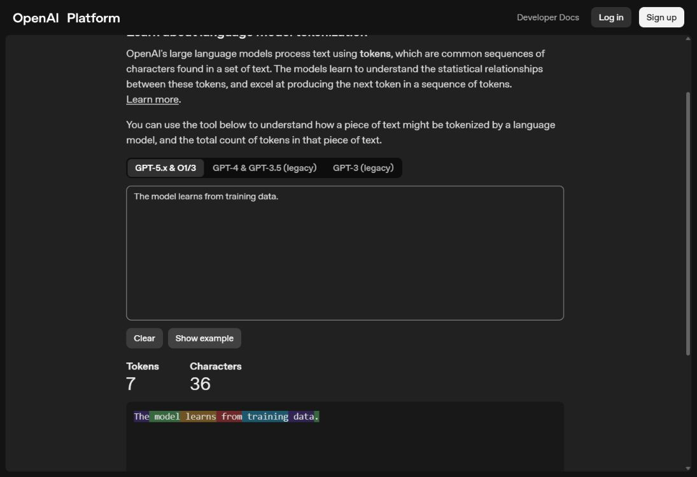
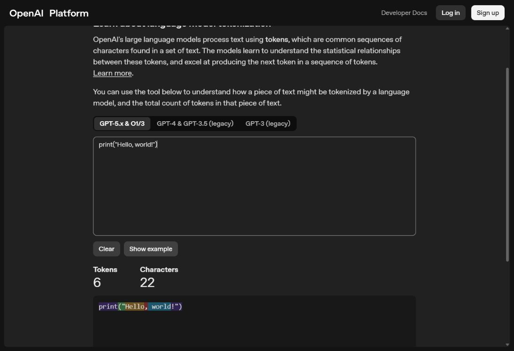
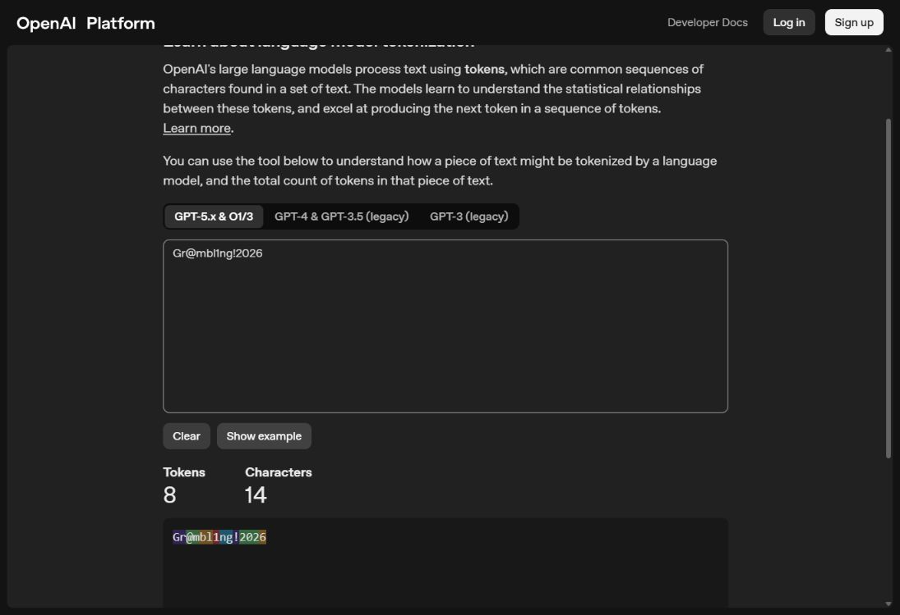

# SecAI+ Lab 1: Laboratory notes

Bright Owusu  
October 14, 2026 (Central Time)

## Purpose and record

I examined how network architecture, training time, and data quality affected a neural network's ability to classify a spiral dataset. I then examined how a tokenizer divided three types of text into tokens. My aim was to relate the observed behavior to generalization, overfitting, and the security implications of unreliable training data.

I organized these notes as a record of the procedure and my interpretation of the evidence. I retained the concise results document as [LAB_REPORT.md](LAB_REPORT.md). The [submission PDF](docs/SecAI_Lab_1.pdf) contains the results and three network screenshots.

## Initial setup

I used the hosted [TensorFlow Playground](https://playground.tensorflow.org/) rather than building or modifying the application in this repository. I selected the spiral dataset and retained classification as the problem type. I used the two original input features, X1 and X2, without adding polynomial or sine features.

I retained the default learning rate of 0.03, Tanh activation, and a batch size of 10. I left regularization set to None and its rate set to 0. These settings remained constant across the three recorded runs. This gave me a common basis for examining the changes in network size and data conditions.

I recorded both training loss and test loss. I treated training loss as a measure of fit to examples used during training. I used test loss to assess performance on examples withheld from training. I did not interpret either loss value as a classification accuracy percentage.

## Entry 1: Establishing the baseline

I began with the default architecture, which contained two hidden layers with four and two neurons. I set noise to 0 and retained 50% of the data for training. The run used seed 0.25258.

I trained the network and paused it at 325 epochs. This was close to the assignment's target of approximately 300 epochs. At this point, I recorded a training loss of 0.433 and a test loss of 0.486.

I observed that the output did not follow the alternating spiral arms well. The relatively high training loss indicated that the network had not fitted even the training examples closely. I therefore treated this result as a weak baseline fit, rather than describing the test loss alone as evidence of overfitting.

The test loss exceeded the training loss by 0.053. I recorded this difference, but I did not use it to conclude that network capacity was the only limitation. A single run at one stopping point cannot establish whether more training would have improved the same architecture.

## Entry 2: Increasing network capacity

I increased the first hidden layer from four neurons to eight. I increased the second hidden layer from two neurons to eight. I then added a third hidden layer and increased it to eight neurons. The resulting architecture was 8, 8, 8.

I retained the clean spiral dataset, 50% training data, and seed 0.25258. I also retained the input features, learning rate, activation, batch size, and regularization settings. I trained the larger network until the output followed the spiral well, then paused it at 1080 epochs.

I recorded a training loss of 0.005 and a test loss of 0.016. Both losses were substantially lower than the baseline values. The test loss decreased by 0.470, while the difference between test loss and training loss was 0.011.

I observed curved regions in the output that followed the two spiral classes. This visual result agreed with the low test loss. I interpreted the combined evidence as successful learning under the recorded clean-data conditions.

I did not treat this comparison as a controlled measurement of architecture alone. I changed both the architecture and the training duration. To isolate the effect of network size, I would compare the architectures at matched epoch counts and repeat the runs with several seeds. I did not perform those additional experiments in this lab.

## Entry 3: Adding noise and limiting training data

I retained the 8, 8, 8 architecture for the final experiment. I changed noise from 0 to 50 and reduced the training-data proportion from 50% to 10%. After these changes, the recorded data seed was 0.38080. I retained the other model settings.

I trained the network again and paused it at 780 epochs. I recorded a training loss of 0.303 and a test loss of 0.611. The test loss exceeded the training loss by 0.308, a much larger difference than in the clean-data run.

I observed that the output no longer formed the clear spiral regions seen in the larger clean-data run. The loss curves also showed a separation between training and test performance. I interpreted this combination as evidence of overfitting: the fitted relationships transferred poorly to the withheld examples.

I also noted that the training loss remained appreciable. The model did not fit the noisy training examples perfectly. Overfitting here refers to the poorer performance on unseen data, rather than complete memorization or a training loss near zero.

I changed noise and the training-data proportion together, as instructed. The data seed and stopping point also differed from the preceding run. I therefore cannot assign the loss increase to one factor independently. My conclusion concerns the combined experimental conditions.

## Security interpretation: Data poisoning

I related the final experiment to the risk of unreliable training data. If an attacker inserts misleading examples or incorrect labels, a model can learn relationships that weaken a defender's classifications. For example, those relationships could contribute to missed attacks or false alarms on legitimate activity.

I distinguished this security interpretation from the procedure I actually performed. I used the Playground noise control; I did not inject malicious examples or test a targeted poisoning attack. The experiment illustrated sensitivity to data conditions, while data poisoning describes intentional manipulation by an adversary.

## Entry 4: Examining tokenization

I opened the [OpenAI Tokenizer](https://platform.openai.com/tokenizer) and used the selected model group, `GPT-5.x & O1/3`. I entered each example separately. I used no leading spaces or final newline and recorded the displayed token and character counts.

| Input type | Exact input | Tokens | Characters |
| --- | --- | --- | --- |
| English sentence | `The model learns from training data.` | 7 | 36 |
| Python statement | `print("Hello, world!")` | 6 | 22 |
| Password-like example | `Gr@mbl1ng!2026` | 8 | 14 |

For the English sentence, I observed seven tokens for 36 characters. The display separated the sentence into familiar word units and a final punctuation token. I noted that spaces can form part of tokens, so token boundaries should not be equated with isolated dictionary words.

For the Python statement, I recorded six tokens for 22 characters. The display grouped some punctuation with adjacent characters. I therefore did not assume that each punctuation mark, word, or programming symbol would receive a separate token.

The password-like example produced eight tokens despite containing only 14 characters. I recorded the displayed pieces as `Gr`, `@m`, `bl`, `1`, `ng`, `!`, `202`, and `6`. This short string required more tokens than either of the longer examples.

I interpreted this result in terms of the tokenizer's vocabulary. An uncommon mixture of letters, numbers, and symbols can require several smaller pieces. Character count alone therefore did not predict token count across these inputs. My recorded counts apply to the selected tokenizer group and the exact strings shown above.

## Final interpretation and limitations

I found that the larger network, after additional training, represented the clean spiral substantially better than the baseline network. Under the combined conditions of high noise and limited training data, I observed a larger gap between training and test loss. These results supported the distinction between fitting available examples and generalizing to unseen examples.

I treated the results as observations from three individual runs. I did not calculate averages, confidence intervals, or classification accuracy. The screenshots preserve the observed stopping points, while the settings links in the report restore configuration rather than trained weights.

The tokenization exercise showed a separate constraint on language-model input: short text can still require many tokens relative to its length. Together, the exercises helped me distinguish the quality of training evidence from the representation of input text. Both affect how I interpret an AI system's behavior, although this lab did not measure a deployed cybersecurity system.
